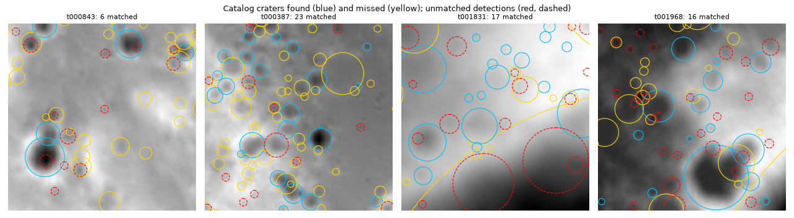
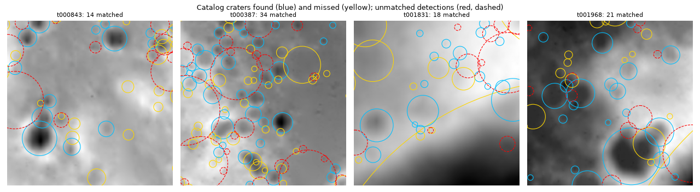
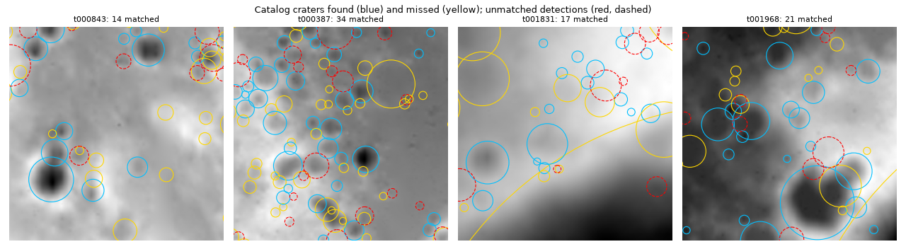

# Baselines

Scores are on tile set v1 with split seed 122, under the protocol in [EVALUATION.md](EVALUATION.md). Settings were tuned on train and val only, and each final setting was run on test once.

| detector | test recall | test precision | test F1 |
| --- | --- | --- | --- |
| Classical radial-slope filter | 0.391 | 0.350 | 0.369 |
| U-Net with ring matching | 0.423 | 0.718 | 0.533 |
| **U-Net plus a large-rim model** | 0.426 | 0.735 | **0.540** |

The U-Net beat the classical filter overall and up to 8 km, but not over 8 km. Adding a large-rim model fixes that: over 8 km it scores F1 0.569, against 0.351 for the U-Net and 0.443 for the classical filter. The overall gain is small because few craters are that large.

## Classical: radial-slope matched filter

`lunar_crater.baselines.classical.RadialSlopeDetector`, with no learning and numpy only.

**Method.** Inside a crater the ground rises towards the rim. For every candidate centre and radius (4 to 100 px, in steps of 8%), the filter averages the slope component pointing outward over an annulus from `inner × r` to `r`. A crater wall scores its slope, flat ground and planar tilt score zero, and a radius past the rim picks up the downhill outer flank and scores lower. Where the annulus is cut by the tile edge or missing data, the local plane is removed first, so edges do not create detections. Local maxima over position and radius are kept and thinned greedily by circle IoU. All scoring is done with FFT correlations, at about 2-3 s per tile on one core (0.47 s per tile with 6 workers).

**Tuning.**

1. **Radius scale, on train.** The slope peaks inside the rim, so raw radii are about 23% too small and most detections miss IoU 0.5. On 200 train tiles the median true/detected radius ratio is 1.30, for every annulus shape tried. Detections are reported at 1.3 × the filter radius. Before this, a 40-tile val check scored F1 0.20; with it, the val grid below scores 0.30 to 0.385.
2. **Shape, on 150 val tiles.** Grid over `inner` and `nms_iou`, each at its best score threshold (`scripts/tune_classical.py`):

   | inner | nms_iou 0.1 | 0.2 | 0.3 | 0.5 |
   | --- | --- | --- | --- | --- |
   | 0.15 | **0.385** | 0.374 | | |
   | 0.3 | 0.381 | 0.370 | 0.367 | 0.357 |
   | 0.5 | | 0.360 | 0.354 | 0.338 |
   | 0.7 | | 0.340 | 0.327 | 0.303 |

   The best setting sits at the edge of the grid, but the last step gained only 0.015 F1, so it was not pushed further.
3. **Threshold, on all val.** On the 450 val tiles, overall F1 peaks at a score of 0.11 (a mean wall slope of about 6 degrees).

**Results** (inner 0.15, nms_iou 0.1, radius_scale 1.3, min_score 0.11):

| diameter (km) | val recall | val precision | val F1 | test recall | test precision | test F1 | test craters |
| --- | --- | --- | --- | --- | --- | --- | --- |
| 1-2 | 0.371 | 0.375 | 0.373 | 0.375 | 0.336 | 0.355 | 9,153 |
| 2-4 | 0.383 | 0.482 | 0.427 | 0.395 | 0.371 | 0.382 | 2,787 |
| 4-8 | 0.529 | 0.447 | 0.485 | 0.531 | 0.388 | 0.448 | 830 |
| 8-16 | 0.532 | 0.594 | 0.561 | 0.534 | 0.398 | 0.456 | 223 |
| 16-32 | 0.316 | 0.561 | 0.405 | 0.426 | 0.537 | 0.476 | 68 |
| 32 and over | 0.040 | – | – | 0.000 | – | – | 28 |
| **all** | **0.388** | **0.411** | **0.399** | **0.391** | **0.350** | **0.369** | 13,089 |



**What it gets wrong.**

- **Degraded craters.** Old craters have shallow walls and soft rims, and many fall under the 6 degree threshold. Lowering the threshold to 0.05 finds 58% of val craters but at 16% precision.
- **The smallest sizes.** 1-2 km craters are 8-17 px across, where DEM noise and the 4 px minimum radius limit the filter. They are 70% of the test craters, so they dominate the overall score.
- **Large craters.** Craters over 32 km are mostly wider than the 100 px largest radius or cut by the tile edge, so the filter cannot see them. The tile size, not the method, sets this limit.
- **Basin floors and slopes.** Curved terrain inside large basins can look like a wall over part of an annulus, which shows up as red dashed circles in the figure.
- **Precision is a lower bound.** Some unmatched detections are real craters missing from the catalog, as noted in the protocol.

Test precision is lower than on val (0.35 against 0.41) while recall is the same. Val was used to pick the threshold, so a small drop is expected. Any learned model has to beat **0.369 test F1** to justify itself.

## U-Net with ring matching

`lunar_crater.models.detector.UNetDetector`: a U-Net predicts a rim probability for each pixel, and `lunar_crater.postprocess.rings.RingMatcher` turns the map into circles.

**Network and training.** A 4-level U-Net with bilinear upsampling and 7.8M parameters. The input is the tile's heights, centred on the tile median and scaled by the tile spread (with a 50 m floor). The target is every catalog rim of at least 1 km, drawn 2 px wide, which is 5.3% of pixels. Training used BCE plus soft Dice, AdamW (learning rate 0.001) with a cosine schedule, batches of 16, and random 90 degree rotations and flips, for 40 epochs on the 2,071 train tiles. It took about 21 minutes on a Colab T4 GPU. Val loss fell almost to the end, with the best at epoch 40 (0.892, train 0.864), so the network was not overfitting and might gain from longer training. This is one run with one seed, so the spread between training runs is not known.

**Ring matching.** For each centre and radius, the score is the mean probability on a ring minus the mean inside it. The subtraction rejects diffuse blobs, which would otherwise score highly at many positions.

**Tuning.**

1. **Radius scale, on train.** Radii come out about 7% small, far less than the classical filter's 23%. On 200 train tiles the fitted scale is 1.072.
2. **Matching, on 150 val tiles.** A grid over ring width (2 px, or 10% or 20% of the radius), NMS overlap (0.1, 0.3) and a size exponent (0, 0.5, 1) that raises the scores of large circles. The top eight settings all score F1 0.550-0.556, so matching has little left to give. The best is a width of 20%, NMS 0.1 and exponent 0.5. Its gain over no size correction (0.552) is too small to mean much.
3. **Threshold, on all val.** F1 is flat at 0.560 between scores of 0.42 and 0.44, and 0.43 was fixed.

**Results** (min_score 0.43):

| diameter (km) | val recall | val precision | val F1 | test recall | test precision | test F1 | classical test F1 |
| --- | --- | --- | --- | --- | --- | --- | --- |
| 1-2 | 0.433 | 0.751 | 0.549 | 0.384 | 0.742 | 0.506 | 0.355 |
| 2-4 | 0.533 | 0.737 | 0.619 | 0.537 | 0.738 | 0.621 | 0.382 |
| 4-8 | 0.496 | 0.624 | 0.552 | 0.510 | 0.645 | 0.569 | 0.448 |
| 8-16 | 0.357 | 0.439 | 0.394 | 0.368 | 0.411 | 0.388 | 0.456 |
| 16-32 | 0.190 | 0.175 | 0.182 | 0.294 | 0.337 | 0.314 | 0.476 |
| 32 and over | 0.000 | – | – | 0.000 | – | – | – |
| **all** | **0.459** | **0.718** | **0.560** | **0.423** | **0.718** | **0.533** | **0.369** |

**Is the difference real?** Bootstrap 95% intervals for U-Net F1 minus classical F1 on test (`scripts/compare_runs.py`). Tiles in one region share terrain, so the region intervals are the fairer test, though 7 regions is few:

| craters | U-Net F1 | classical F1 | resampling tiles | resampling the 7 regions |
| --- | --- | --- | --- | --- |
| all | 0.533 | 0.369 | +0.15 to +0.18 | +0.10 to +0.24 |
| 1-8 km | 0.538 | 0.368 | +0.15 to +0.19 | +0.10 to +0.25 |
| over 8 km | 0.351 | 0.443 | -0.14 to -0.05 | -0.17 to +0.02 |

The overall gain holds under both tests. The classical lead over 8 km is clear across tiles but not conclusive across regions.



**What it gets wrong.**

- **Large craters.** This is the main weakness. Large rims are predicted less completely, and the matcher can build a large false circle from arcs of several smaller rims (the big red dashed circles in the figure). Only 319 test craters are over 8 km, so these bins move little in the overall score.
- **Craters over 32 km.** None were found. Like the classical filter, the matcher tries radii only up to 100 px, and most of these rims are cut by the tile edge.
- **Missed small craters.** Recall on 1-2 km craters is 0.38 on test, the largest source of missed craters. Precision there is 0.74, and it is a lower bound because the catalog is least complete at that size.
- **Test against val.** Test F1 is 0.027 below val, mostly from recall on 1-2 km craters (0.384 against 0.433). The two splits cover different regions, so this may be terrain rather than overfitting. The 16-32 km row differs in the other direction, but it has under 100 craters per split.

The next models have **0.533 test F1** to beat, and large craters are the clearest place to gain. Test has now been used once for each of these two detectors.

## U-Net plus a large-rim model

`UNetDetector` with `large_checkpoint` set. `unet_v1` finds craters under 6 km. A second network, averaged over three seeds, finds those of 6 km and wider.

**Network and training.** The same U-Net with a second output, read from the decoder at quarter resolution and upsampled. Its target is the rims of craters of at least 6 km, drawn 4 px wide. It is meant to stop false large circles built from arcs of small rims, since this output never learns small rims. Both outputs share one network and train together with BCE plus soft Dice, for 60 epochs per seed (about 32 minutes each on a Colab T4). The best epochs were 53, 56 and 59, so val loss had flattened by the end.

**What the val scores showed** (all 450 val tiles, each at its best threshold):

| option | all | 1-2 km | 8-16 km | 16-32 km |
| --- | --- | --- | --- | --- |
| `unet_v1` alone | 0.560 | 0.548 | 0.397 | 0.192 |
| Two-output network, each of 3 seeds alone | 0.539 | 0.519-0.522 | 0.387-0.398 | – |
| Two-output network, seeds averaged | 0.543 | 0.526 | 0.394 | – |
| Averaged, with its large output above 6 km | 0.550 | 0.527 | 0.652 | 0.331 |
| `unet_v1`, classical filter above 6 km | 0.566 | 0.548 | 0.553 | 0.386 |
| **`unet_v1`, large output above 6 km** | **0.571** | **0.548** | **0.681** | **0.338** |

- **The large output works.** At 8-16 km it clearly beats both the main map and the classical filter.
- **The main output got worse.** Its val loss on the main output is 0.902-0.907, against 0.892 for `unet_v1`, despite longer training. The likely cause is sharing the network with the second output, but no run isolates that. The three seeds agree to within 0.001 F1, so this is not one bad run.
- **Averaging seeds helped little.** It added 0.004 F1 on the main map. In a one-off val check, averaging `unet_v1` with the three seeds' main maps scored 0.552 with the large output, against 0.572 with `unet_v1` alone, so small craters use `unet_v1` by itself.

**Tuning.**

1. **Radius scale, on train.** The large output's radii need a scale of 1.032, on 200 train tiles.
2. **Sources, cut and gain, on all val.** A grid over the source, the size cut (6, 8 km) and a gain that puts large-crater scores on the main map's scale (`scripts/tune_large.py`). Gains of 1.0 and 1.25 at 6 km are tied overall (0.5718 and 0.5713). Gain 1.25 was chosen because it is better over 8 km.
3. **Threshold, on all val.** F1 peaks at a score of 0.435.

**Results** (cut 6 km, gain 1.25, min_score 0.435):

| diameter (km) | val recall | val precision | val F1 | test recall | test precision | test F1 | U-Net test F1 | classical test F1 |
| --- | --- | --- | --- | --- | --- | --- | --- | --- |
| 1-2 | 0.429 | 0.756 | 0.548 | 0.382 | 0.746 | 0.505 | 0.506 | 0.355 |
| 2-4 | 0.530 | 0.746 | 0.619 | 0.534 | 0.748 | 0.623 | 0.621 | 0.382 |
| 4-8 | 0.526 | 0.646 | 0.580 | 0.530 | 0.648 | 0.583 | 0.569 | 0.448 |
| 8-16 | 0.620 | 0.754 | 0.681 | 0.605 | 0.667 | 0.635 | 0.388 | 0.456 |
| 16-32 | 0.215 | 0.786 | 0.338 | 0.279 | 1.000 | 0.437 | 0.314 | 0.476 |
| 32 and over | 0.000 | – | – | 0.000 | – | – | – | – |
| **all** | **0.464** | **0.742** | **0.571** | **0.426** | **0.735** | **0.540** | **0.533** | **0.369** |

**Is the difference real?** Bootstrap 95% intervals for this detector's F1 minus each other detector's, on test:

| craters | this F1 | other F1 | resampling tiles | resampling the 7 regions |
| --- | --- | --- | --- | --- |
| all, against the U-Net | 0.540 | 0.533 | +0.005 to +0.009 | +0.004 to +0.010 |
| 1-8 km, against the U-Net | 0.539 | 0.538 | -0.001 to +0.002 | 0.000 to +0.001 |
| over 8 km, against the U-Net | 0.569 | 0.351 | +0.17 to +0.27 | +0.16 to +0.27 |
| all, against classical | 0.540 | 0.369 | +0.15 to +0.19 | +0.10 to +0.25 |
| over 8 km, against classical | 0.569 | 0.443 | +0.07 to +0.18 | +0.07 to +0.24 |

The gain over 8 km holds under both tests. The overall gain is small but consistent, and comes entirely from those large craters and the 4-8 km craters near the cut. Under 4 km it changes almost nothing.



**What it gets wrong.**

- **Small craters are unchanged.** Recall on 1-2 km craters is still 0.38 on test, and they are 70% of test craters. This is now the largest gap.
- **16-32 km is thin.** The detector makes only 20 detections in this bin on test. All 20 match, but recall is 0.28, and with 68 craters the score moves a lot on few matches. The classical filter's 0.476 is still higher in this one bin.
- **Craters over 32 km.** None were found, for the same reason as before.
- **Four networks for one prediction.** It runs `unet_v1` and three seeds. A later val check found one seed as good as three, so the served model uses seed 0 only and scores test F1 0.539 ([SERVING.md](SERVING.md)).
- **Possible retraining.** Training the second output without weakening the main one might beat this mix. That has not been tried.

Test has now been used once for each of these three detectors, and once more for the served version in [SERVING.md](SERVING.md).

## Reproduce

Training needs a GPU: pack the tiles with `python scripts/pack_tiles.py data/interim/tiles/v1 data/processed/lunar_tiles_v1.zip`, upload the zip to `MyDrive/lunar_crater/` in Google Drive, and run [notebooks/train_unet_colab.ipynb](../notebooks/train_unet_colab.ipynb) on Colab. Put the resulting `best.pt`, `config.json` and `history.csv` in `models/unet_v1/`. Weights are not stored in this repository.

```bash
python scripts/tune_unet.py data/interim/tiles/v1 models/unet_v1/best.pt outputs/tune_unet.csv
python -m lunar_crater.evaluation.harness data/interim/tiles/v1 --split val --detector unet --workers 5 \
    --set checkpoint=models/unet_v1/best.pt thickness_frac=0.2 nms_iou=0.1 size_exponent=0.5 radius_scale=1.072 \
    --out outputs/unet_v1_val
python -m lunar_crater.evaluation.harness data/interim/tiles/v1 --split test --detector unet --workers 5 \
    --set checkpoint=models/unet_v1/best.pt thickness_frac=0.2 nms_iou=0.1 size_exponent=0.5 radius_scale=1.072 \
    --min-score 0.43 --out outputs/unet_v1_test
python scripts/compare_runs.py data/interim/tiles/v1 outputs/unet_v1_test outputs/classical_v1_test
python scripts/plot_detections.py data/interim/tiles/v1 outputs/unet_v1_val docs/figures/unet_val.png --min-score 0.43
```

For the U-Net plus large-rim model, run the notebook as it stands (three seeds, 60 epochs) and put each seed's files in `models/ms_unet_v1/seed0/`, `seed1/` and `seed2/`. `$SEEDS` is the three `best.pt` paths joined by commas:

```bash
python scripts/tune_unet.py data/interim/tiles/v1 $SEEDS outputs/ms_unet_v1_tune/main_map.csv
python scripts/tune_large.py data/interim/tiles/v1 $SEEDS outputs/ms_unet_v1_tune/large.csv \
    --thickness-frac 0.1 --nms-iou 0.1 --size-exponent 0.0 --gains 0.75 1 1.5 2 3 4
python scripts/tune_large.py data/interim/tiles/v1 models/unet_v1/best.pt outputs/ms_unet_v1_tune/unet_v1_hybrid.csv \
    --sources classical --cuts-km 6 --gains 2 3 4
python scripts/tune_large.py data/interim/tiles/v1 $SEEDS outputs/ms_unet_v1_tune/mixed.csv \
    --main-checkpoint models/unet_v1/best.pt --sources head --gains 1 1.25 1.5 2
python -m lunar_crater.evaluation.harness data/interim/tiles/v1 --split test --detector unet --workers 6 \
    --set checkpoint=models/unet_v1/best.pt large_checkpoint=$SEEDS thickness_frac=0.2 nms_iou=0.1 \
    size_exponent=0.5 radius_scale=1.0723 large_source=head large_from_km=6 large_gain=1.25 \
    large_radius_scale=1.0318 large_min_score=0.03 \
    --min-score 0.4348964732855996 --out outputs/ms_unet_v1_test
python scripts/compare_runs.py data/interim/tiles/v1 outputs/ms_unet_v1_test outputs/unet_v1_test
python scripts/compare_runs.py data/interim/tiles/v1 outputs/ms_unet_v1_test outputs/classical_v1_test
```

For the classical filter:

```bash
python scripts/tune_classical.py data/interim/tiles/v1 outputs/tune_classical.csv --workers 6
python -m lunar_crater.evaluation.harness data/interim/tiles/v1 --split val --workers 6 \
    --set inner=0.15 nms_iou=0.1 radius_scale=1.3 --out outputs/classical_v1_val
python -m lunar_crater.evaluation.harness data/interim/tiles/v1 --split test --workers 6 \
    --set inner=0.15 nms_iou=0.1 radius_scale=1.3 --min-score 0.11 --out outputs/classical_v1_test
python scripts/plot_detections.py data/interim/tiles/v1 outputs/classical_v1_val \
    docs/figures/classical_val.png
```

The harness refuses to run on test without `--min-score`, so a threshold cannot be tuned there by accident. Each run folder holds `predictions.csv`, `sweep.csv` (precision and recall at each threshold), `metrics.csv` and `run.json`.
